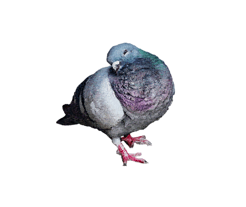

# 42

Welcome to the 42 repository! This project is part of the curriculum at [42 School](https://42.fr/en/homepage/), a unique and innovative approach to learning software development. This repository contains my solutions, projects, and explorations during my time at 42.

## About 42 School

42 is a peer-to-peer learning institution that offers a revolutionary approach to education in software engineering. With no teachers, no classes, and no formal lectures, students learn through hands-on projects and collaboration with their peers. The curriculum is designed to foster creativity, problem-solving, and self-directed learning.

## Repository Structure

	42/  
	├── Piscine/			# Prologue: Projects of the piscine at 42  
	└── ...				# More projects to come!  
	
## How to Use This Repository 
Clone the repository:
 
	git clone https://github.com/Drareg04/42.git

## Have fun! 

42 Student    
TacticalPigeon   

## Disclaimer:
This repository is for educational purposes and is part of the 42 School curriculum. Some projects may be subject to specific guidelines or restrictions set by 42.
